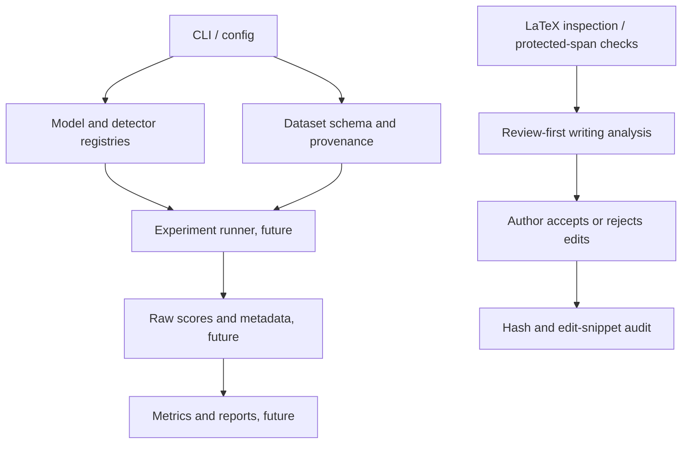

# ATEval — Academic Text Evaluation & Writing Intelligence

ATEval is a local-first research platform for academic writing analysis, human-revision-inspired editing, document preservation, and reproducible NLP research. Linguistic features and model scores are experimental signals; they are not proof of authorship or misconduct.

This alpha research preview includes a Python CLI and API, a React workspace, manuscript ingestion and analysis, experimental revision methods, and research documentation. The UI uses Poppins.

## Release status

ATEval is an **alpha research preview**, not production-ready or scientifically
validated. Formal publication remains blocked pending ownership and licence
verification, clean installation checks on the claimed platforms, Docker
runtime verification, and independent security and privacy review. Hosted
Linux CI and a local macOS check must not be presented as Windows support. See
[known limitations](docs/known_limitations.md),
[privacy statement](PRIVACY.md), and [security policy](SECURITY.md).

| Feature | Status |
|---|---|
| Local manuscript ingestion and source mapping | Implemented; `.txt`, `.tex`, and LaTeX ZIP exercised in UI; DOCX/PDF optional |
| Academic quality diagnostics | Implemented as descriptive analysis, not authorship detection |
| Academic revision suggestions | Experimental; author review required; semantic equivalence not established |
| Revision-intention classifier | Experimental and weak; advisory only |
| AI-writing detector algorithms | Unavailable; no detector is implemented |
| Model-backed generation | Optional and user-managed; no checkpoint bundled or downloaded automatically |
| Public confidential-manuscript upload | Disabled/not offered; independent review required |

## Quick start

Requires Python 3.11 or newer; the foundation uses only the standard library.

```sh
python -m ateval --help
python -m ateval doctor
python -m ateval detector list
python -m unittest discover -s tests -v
```

To install the CLI in an environment, run `python -m pip install -e .`. No model or dataset download is performed. Optional model packages are not installed automatically.

## Local graphical workspace

Install the local API dependencies and frontend packages:

```sh
python -m pip install -e ".[ui-server,revision-ml]"
cd frontend && npm install
```

Start the API and frontend in separate terminals from the repository root:

```sh
python -m ateval api
```

```sh
cd frontend && npm run dev
```

Open `http://127.0.0.1:5173`. The API and Vite server bind to loopback. SQLite metadata and imported dataset copies are stored under `.ateval/` in the current working directory. The UI supports local CSV/JSONL import and validation, saved experiment drafts, detector catalogue browsing, local LaTeX source inspection, academic writing analysis with author-reviewed proposals, workspace inventory export, and persistent theme settings. Writing analysis accepts `.txt`/`.tex` directly and optional `.docx`/text-layer `.pdf` extraction. It does not overwrite source files; audit records contain hashes, decisions, and edit snippets, not full manuscripts.

For a built local production run, build the UI once with `cd frontend && npm run build`, then run `python -m ateval api` and open `http://127.0.0.1:8000`. FastAPI serves `frontend/dist/client` and `/api/v1` from that same loopback origin. The upload limit defaults to 25 MiB and can be set with `ATEVAL_UPLOAD_LIMIT_BYTES`. The separately packaged Sites worker serves static files only; it intentionally returns missing `/api` requests as API errors instead of routing them to the SPA. Do not use a hosted static Sites deployment to submit unpublished manuscripts.

See [installation](docs/installation.md) for native and Docker Compose setup,
[quick start](docs/quick_start.md), and [troubleshooting](docs/troubleshooting.md).

The UI does not execute detector jobs, generate research scores, compile LaTeX, or prove semantic equivalence. The writing workspace now includes SCAR, a selective local revision prototype with an explicit author-intent gate, typed protection for numbers/citations/LaTeX and user terms, fail-closed checks, and author approval before applying a suggestion. XtraGPT must be installed locally for requested edits; no model weights are bundled or downloaded automatically.

The **Manuscript Intelligence** page analyzes `.txt`, `.tex`, LaTeX project `.zip`, `.docx`, and text-layer `.pdf` files with source-mapped passages, optional local SCAR proposals, author review, audit history, and source-format export where mappings are supported. PDF remains read-only. LaTeX ZIP imports preserve untouched project assets. Since no detector in the registry is currently implemented, manuscript reports correctly show detector analysis as unavailable and do not infer authorship from linguistic features. Read the [M4.5 implementation report](docs/milestone_4_5_report.md) for support boundaries and validation details.

Analyze a manuscript from the CLI without changing its source:

```sh
python -m ateval writing analyze paper.tex --output paper-review.json
```

Optional local NLP and document extraction dependencies can be installed with `python -m pip install -e '.[writing]'`. These packages do not download language-model weights. Install an authorized spaCy English pipeline separately if parser-backed syntax diagnostics are needed. The lightweight baseline works without these extras.

Read the [human writing research review](docs/human_writing_research.md) and [evaluation protocol](docs/writing_engine_evaluation.md) before interpreting any feature or using benchmark data.

Milestone 3 adds IteraTeR-HUMAN ingestion, deterministic document-grouped splits, word/character TF-IDF intent baselines, context ablations, and a held-out generation comparison. Read the [Milestone 3 report](docs/milestone_3_report.md), [initial audit](docs/milestone_3_initial_audit.md), [dataset ingestion report](docs/dataset_ingestion_report.md), [dataset quality report](docs/dataset_quality_report.md), and [human evaluation protocol](docs/revision_experiment_protocol.md). Research datasets and generated model outputs are intentionally not bundled; obtain them under their own terms and place them in the documented paths before reproducing the CPU benchmark:

```sh
python -m pip install -e '.[revision-ml]'
python -m ateval revisions benchmark-intent \
  data/processed/iterater_human_grouped_v1/sentence_train.jsonl \
  data/processed/iterater_human_grouped_v1/sentence_dev.jsonl \
  data/processed/iterater_human_grouped_v1/sentence_test.jsonl \
  --train-documents data/processed/iterater_human_grouped_v1/document_train.jsonl \
  --dev-documents data/processed/iterater_human_grouped_v1/document_dev.jsonl \
  --test-documents data/processed/iterater_human_grouped_v1/document_test.jsonl \
  --source-license Apache-2.0 --license-verified --output-dir models/revisions/iterater_human_grouped_rerun_v1
```

arXivEdits still requires a per-paper/per-version license manifest and explicit allowed license identifiers. The tool does not infer permission. Classical intent scores are exploratory and weak on rare categories; no expert evaluation or transformer fine-tuning is claimed.

The frozen DistilBERT contextual-embedding comparison is reproducible with the optional `revision-transformer` extra. It downloads the pinned Apache-2.0 checkpoint only when explicitly allowed and stores it in a Hugging Face cache outside the project by default:

```sh
python -m pip install -e '.[revision-transformer]'
python scripts/benchmark_distilbert_intent.py \
  data/processed/iterater_human_grouped_v1/sentence_train.jsonl \
  data/processed/iterater_human_grouped_v1/sentence_dev.jsonl \
  data/processed/iterater_human_grouped_v1/sentence_test.jsonl \
  --train-documents data/processed/iterater_human_grouped_v1/document_train.jsonl \
  --dev-documents data/processed/iterater_human_grouped_v1/document_dev.jsonl \
  --test-documents data/processed/iterater_human_grouped_v1/document_test.jsonl \
  --allow-model-download --output-dir models/revisions/iterater-distilbert-run-2
```

This is a frozen encoder plus supervised logistic head, not transformer fine-tuning. Its test macro-F1 was 0.1964 (sentence) and 0.1639 (local context); it is not integrated into the UI because it did not show an advantage over the TF-IDF baseline.

Milestone 4 documents the intent-model failure analysis, expanded corpus/licence review, and optional local generation runners in the [M4 report](docs/milestone_4_report.md) and [extended research review](docs/extended_revision_research.md). The CLI supports reviewable local proposals with XtraGPT or a general instruction model, plus official sentence-only IteraTeR BART/PEGASUS inference when local weights and checkpoint rights are available. Models are never downloaded automatically. The XtraGPT/Ateval adapter checks protected spans, requires review, and marks semantic equivalence as unassessed:

```sh
python -m pip install -e '.[revision-transformer]'
python -m ateval revisions propose \
  "The original academic sentence." \
  --paragraph-context "Relevant surrounding paragraph." \
  --section discussion \
  --instruction "Improve clarity without changing the claim." \
  --model-path /path/to/local/XtraGPT-checkpoint
```

SCAR can return a no-edit or abstention decision without loading a model. For an explicit editing request, the local XtraGPT model must be available in Ollama. The 30-item document-disjoint development comparison and original M4.1 588-item evaluation are described in the [M4.2 experiment report](docs/milestone_4_2_experiment_report.md); machine-generated predictions and report artifacts are not bundled. SCAR is not scientifically validated; its automatic checks do not establish semantic equivalence, and qualified human evaluation remains pending. See the [failure taxonomy](docs/milestone_4_2_failure_taxonomy.md), [protected-content design](docs/protected_content_architecture.md), and [SCAR specification](docs/scar_algorithm_specification.md).

Run the SCAR revision gate from the CLI; replace the sentence and paragraph with your own text. Use `--author-requested-edit` and an intention to invoke local generation. Without that flag or with `--intention no_edit`, SCAR returns the source unchanged without inference:

```sh
python -m ateval revisions scar-revise \
  "The selected academic sentence." \
  --paragraph-context "The selected academic sentence. Its neighboring context explains the claim." \
  --intention clarity --author-requested-edit
```

Run frontend production build and packaged-site checks with `cd frontend && npm run build && npm run test:sites`. Run the Python suite with `PYTHONPATH=. pytest -q`.

## Current scope

Implemented: TOML configuration, JSON/text structured logging, an explicit detector/model registry, a provenance-preserving dataset record schema, CLI runtime/status commands, a loopback FastAPI service with SQLite experiment metadata, the React local workspace, a review-first writing-analysis baseline, trained document-held-out classical revision-intent models, local academic generation, and the SCAR revision prototype. Human no-edit annotations, qualified reviewer outcomes, learned necessity calibration, semantic equivalence validation, author-held-out evaluation, transformer fine-tuning for ATEval, and detector algorithms remain unavailable or out of scope.

See [implementation audit](docs/implementation_audit.md), [literature review](docs/literature_review.md), and [algorithm matrix](docs/algorithm_implementation_matrix.md).

## Architecture



Experiments must preserve source, label, dataset version, split and generator metadata. Local/offline behavior is the default; future network access must be explicit and visible.
