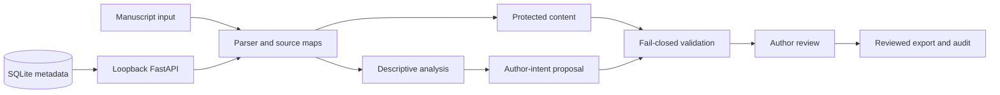

<div align="center">
  

  <p><strong>Academic Text Evaluation &amp; Writing Intelligence</strong></p>
  <p>Local-first academic manuscript revision that improves expression while preserving research content and author control.</p>

  <p>
    <a href="docs/installation.md"></a>
    <a href="docs/architecture.md"></a>
    <a href="docs/RESEARCH.md"></a>
    <a href="docs/EVALUATION.md"></a>
    <a href="docs/ROADMAP.md"></a>
  </p>
  <p>
    <a href="https://github.com/ShyamSathish005/ATEval/actions/workflows/ci.yml"></a>
    
    
    <a href="LICENSE"></a>
  </p>
</div>

> **Experimental alpha:** ATEval is not scientifically validated and every revision requires author review. The initial release targets macOS with a user-managed loopback Ollama model. The stylometric research signal is not an authorship detector and must not be used for authorship, misconduct, or academic-integrity determinations.

> **Product promise:** Improve your academic writing. Preserve your research.

## What ATEval is

ATEval investigates the difference between **rewriting text** and **revising academic writing responsibly**. It combines manuscript ingestion, source mapping, descriptive analysis, revision-intention experiments, protected-content checks, selective revision prototypes, and author-controlled review in a local-first workspace.

The design priorities are:

- preserve technical meaning, numbers, citations, terminology, and document structure;
- make revision intent explicit before proposing a change;
- abstain when automated checks cannot establish safety;
- keep datasets, model checkpoints, prompts, hashes, and evaluation splits reproducible;
- separate research infrastructure from claims about writing quality or authorship.

## Navigation

| Start | Humanizer | Research | Project |
|---|---|---|---|
| [Installation](docs/installation.md) · [Quick start](docs/quick_start.md) | [MVP scope](docs/MVP_SCOPE.md) · [User guide](docs/USER_GUIDE.md) | [Research](docs/RESEARCH.md) · [Evaluation](docs/EVALUATION.md) | [Contributing](CONTRIBUTING.md) · [Security](SECURITY.md) |
| [Troubleshooting](docs/troubleshooting.md) · [OS notes](docs/os_installation.md) | [Privacy](docs/PRIVACY_AND_DATA_HANDLING.md) · [Data handling](docs/DATASETS_AND_LICENSING.md) | [Model setup](docs/MODEL_SETUP.md) · [Limitations](docs/ALPHA_LIMITATIONS.md) | [Roadmap](docs/ROADMAP.md) · [Changelog](CHANGELOG.md) |

## Capability matrix

| Capability | Status | Evidence and boundary |
|---|---|---|
| Local CLI, API, and React workspace | **Available** | `ateval/`, `frontend/`, and the tested CI workflow |
| Academic Humanizer workspace | **Available for local review** | Source-mapped proposals, author decisions, undo, and approved export |
| `.txt` and `.tex` manuscript ingestion | **Available** | Source-mapped local analysis; no TeX compilation |
| LaTeX project ZIP ingestion | **Available** | Validated archive paths and preserved project assets |
| DOCX and text-layer PDF ingestion | **Experimental** | Optional document dependencies; PDF output is read-only |
| Descriptive academic-writing analysis | **Available** | Linguistic signals only; not authorship evidence |
| Revision-intention classifier | **Experimental** | Grouped baselines are advisory and weak on rare classes |
| SCAR selective revision pipeline | **Experimental** | Protected spans, fail-closed checks, and author approval required |
| Model-backed generation | **Supported configuration verified** | macOS + loopback Ollama + `ateval-xtragpt-1_5b-q8_0`; no weights bundled; author review remains required |
| Human-evaluation workflow | **Infrastructure available** | Blinded packet and annotation tooling exist; qualified outcomes remain pending |
| AI-writing evaluator baseline | **Experimental** | Deterministic stylometric signal; no calibration, benchmark, or authorship conclusion |
| Public confidential-manuscript service | **Not offered** | Local loopback workflow only; review [privacy](docs/PRIVACY_AND_DATA_HANDLING.md) |

## Quick start

Requires Python 3.11 or newer. The base install does not download models or datasets.

```sh
git clone https://github.com/ShyamSathish005/ATEval.git
cd ATEval
./scripts/install_macos.sh
./scripts/run_ateval.sh
```

The macOS installer creates a virtual environment, installs local document
support, builds the frontend, and runs the doctor check. It does not download
model weights or datasets. See [installation](docs/installation.md) for the supported macOS path and
explicitly unverified alternatives.

For the local UI and document extraction:

```sh
python -m pip install -e ".[ui-server,writing-docs]"
cd frontend && npm ci && npm run build
cd ..
python -m ateval api
```

Open `http://127.0.0.1:8000` after the production build. Development mode uses `cd frontend && npm run dev` and proxies `/api` to the loopback API.

Analyze a manuscript without overwriting its source:

```sh
python -m ateval writing analyze paper.tex --output paper-review.json
```

## System architecture



ATEval reads uploads locally, builds in-memory projections, and stores local metadata under `.ateval/`. Optional model inference is explicitly user-managed. It does not execute document shell commands, compile LaTeX, or prove semantic equivalence. See the [architecture guide](docs/architecture.md).

## Research and evaluation

ATEval treats revision as a constrained, reviewable research problem rather than arbitrary paraphrasing. The repository includes literature reviews, document-grouped IteraTeR-HUMAN experiments, SCAR gate analysis, protected-span regression tests, failure analysis, and blinded human-evaluation infrastructure.

Results are deliberately qualified:

- XtraGPT local inference is documented as an experimental generator, not a safe automatic editor.
- BLEU, ROUGE, edit rate, and classifier metrics are overlap or diagnostic measurements, not proof of better academic writing.
- Automated structural checks do not establish semantic equivalence.
- M4.4 provides reviewer infrastructure, but no simulated reviewer responses are presented as evidence.

Read [Research & Evaluation](docs/RESEARCH.md), [evaluation details](docs/EVALUATION.md), and the [research methodology](docs/research_methodology.md) before interpreting any result.

## Data, licensing, and privacy

Project-authored material is released under MIT according to the owner's recorded confirmation. Dependencies, fonts, model checkpoints, datasets, source passages, and derived research artifacts retain their own licences and are not implicitly covered by MIT. See [datasets and licensing](DATASET_LICENSES.md), [model licences](MODEL_LICENSES.md), and [privacy](docs/PRIVACY_AND_DATA_HANDLING.md).

The default workflow binds to loopback. Do not send unpublished manuscripts to a remote model or hosted deployment without an independent privacy review. Raw research data and generated experiment outputs are excluded from release archives.

## Release status

This is the **v0.1.0-alpha.1 experimental release**. See the [project status](docs/PROJECT_STATUS.md) for supported platforms, verified capabilities, and limitations.

## Contributing and citation

Contributions should preserve provenance, reproducibility, and the distinction between descriptive signals and scientific claims. Start with [CONTRIBUTING.md](CONTRIBUTING.md) and [SECURITY.md](SECURITY.md). Citation metadata is available in [CITATION.cff](CITATION.cff).
