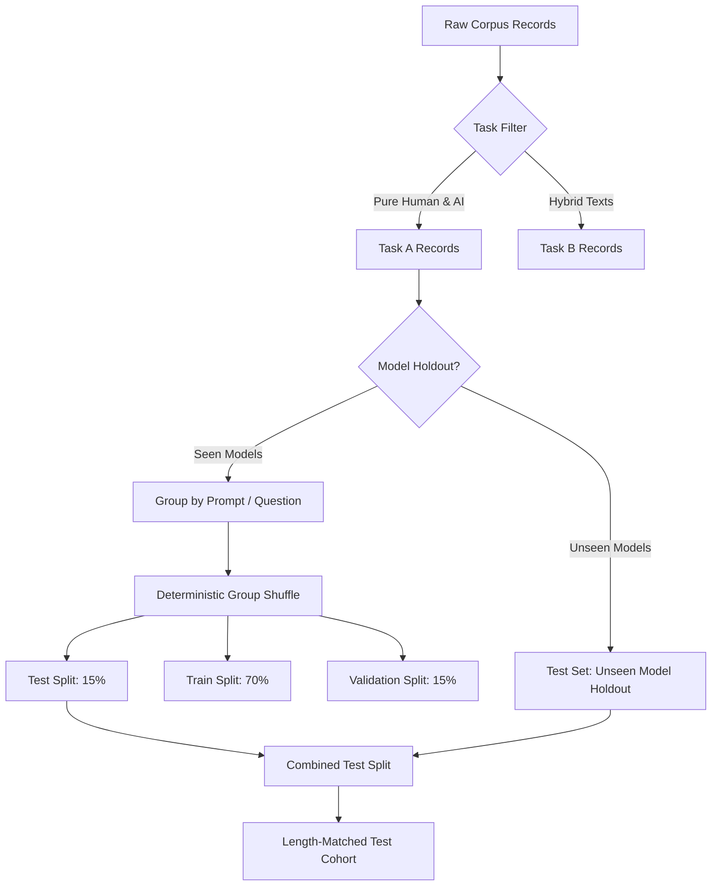

# ATEval Detection Benchmark Protocol (M5.1)

## Overview

The ATEval detector benchmark protocol defines an empirical, scientifically honest evaluation harness for AI-generated text detection in academic writing.

The protocol enforces four core principles:
1. **Task Isolation:** Never force mixed-authorship or out-of-domain texts into artificial binary classes.
2. **Leakage Resistance:** Never split records randomly by row; enforce group-based splitting by prompt, document, and author.
3. **Validation Honesty:** Never expose test split data during threshold calibration or feature selection.
4. **Epistemic Modesty:** Never report raw stylometric heuristics as "authorship probabilities" or claim calibrated confidence without independent calibration.

---

## 1. Benchmark Task Definitions

### Task A: Human versus AI Text (Binary)
- **Target:** Distinguish pure human-authored scholarly prose from pure AI-generated text.
- **Label Mapping:** 
  - `label = "human"` (Ground truth: 0)
  - `label = "ai"` (Ground truth: 1)
- **Exclusion Rule:** Mixed-authorship texts (`label = "mixed"`) are strictly excluded from Task A to preserve pure binary classification validity.
- **Primary Metrics:** AUROC, AUPRC, Precision, Recall, F1, False Positive Rate (FPR), False Negative Rate (FNR), Accuracy, 95% Bootstrap Confidence Intervals.

### Task B: Mixed Authorship Evaluation
- **Target:** Characterize detector behavior on hybrid, collaboratively edited, or AI-refined texts.
- **Classes Evaluated:**
  1. `AI-generated + Human-written`
  2. `AI-generated + AI-refined`
  3. `Human-written + AI-refined`
  4. `AI-generated + AI-refined + Human-written`
- **Methodology:** Rather than forcing hybrid texts into arbitrary binary truth labels, Task B reports signal distributions, mean scores, and transition sensitivities.

### Task C: Academic-Domain Generalisation
- **Target:** Evaluate whether detection signals transfer across domains without severe performance degradation or elevated false positives.
- **Methodology:** Evaluates academic prose (in-domain) against out-of-domain cohorts (news, open QA, encyclopedia entries).

### Task D: Passage-Level Localisation
- **Target:** Evaluate sentence- and span-level detection precision and recall.
- **STRICT PROHIBITION:** Converting whole-document labels into sentence-level or passage-level ground truth is strictly prohibited.
- **Enforcement:** Task D only admits corpora with explicitly annotated character spans (`SpanAnnotation`). When span ground truth is absent, detectors report passage features as diagnostic observations without claiming span-level accuracy metrics.

---

## 2. Leakage-Resistant Splitting Protocol

### Partitioning Rules

1. **Prompt Grouping:** All responses elicited by the same question or prompt belong strictly to the same partition. Zero prompt overlap between train, validation, and test.
2. **Document Grouping:** When multiple paragraphs originate from a single document, the entire document resides in one partition.
3. **Author Grouping:** All human samples from a given participant/author are assigned to a single partition.
4. **Unseen Generator Holdout:** Specified modern generator architectures (e.g., Gemini, LLaMA, Grok) are held out entirely from training and validation, appearing only in the test set to measure cross-generator generalization.
5. **Length-Matched Cohort:** To isolate stylometric signals from superficial text-length cues, a length-matched test subset is extracted by binning word counts and sampling equal numbers of human and AI records per bin.

---

## 3. Threshold Selection and Statistical Reporting

1. **Threshold Determination:** The decision threshold is selected exclusively on the **validation split** using Youden's J statistic ($J = \text{Recall} - \text{FPR}$) or validation F1.
2. **Zero Test Contamination:** The test split is evaluated exactly once using the frozen validation threshold.
3. **Bootstrap Confidence Intervals:** 95% empirical confidence intervals are estimated via 500 bootstrap iterations with replacement over the test split.
4. **Feature Association:** Point-biserial correlations ($r_{pb}$) are computed between each continuous stylometric feature and the binary ground-truth label to verify whether separation reflects meaningful style or trivial confounding artifacts.

