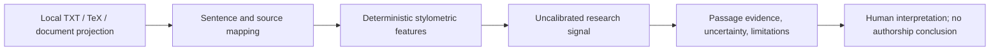

# Detector architecture

## Current execution path

The current `stylometric-baseline` computes type-token ratio, sentence-length
variation, function-word ratio, punctuation density, and repeated trigram rate.
Its score is a transparent heuristic, not a trained classifier, calibrated
probability, or ground truth label. Other registered methods remain planned.

The existing manuscript analysis pipeline attaches this method to source-mapped
passages. The API also exposes `/api/v1/evaluator/stylometric` for reproducible
single-text evaluation.
