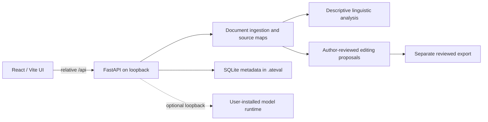

# Architecture

Development uses Vite's `/api` proxy. The native built application serves UI
and API from one FastAPI origin. Docker builds the UI in a Node stage and
copies static assets into the Python runtime image. The default Docker Compose
port map binds host loopback only.

Manuscript analysis reads upload bytes, builds in-memory source projections,
and returns source maps. It does not compile LaTeX or execute document shell
commands. ZIP imports validate archive paths, symlinks, duplicates, file
count, and expanded bytes. Local database state and user-imported datasets
are separate from raw manuscript analysis; see [Privacy](../PRIVACY.md).

Model inference is optional and separated from ingestion. API calls to an
Ollama-compatible service are an explicit local configuration. A remote model
endpoint can disclose manuscript contents and must not be used with private
work unless independently approved.
